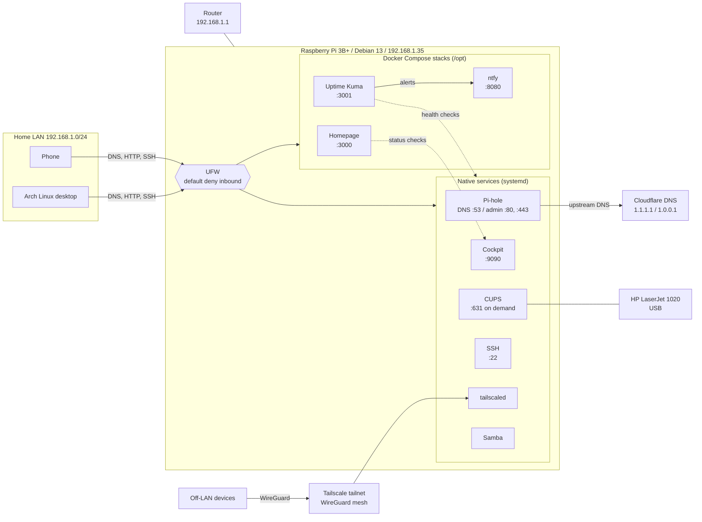
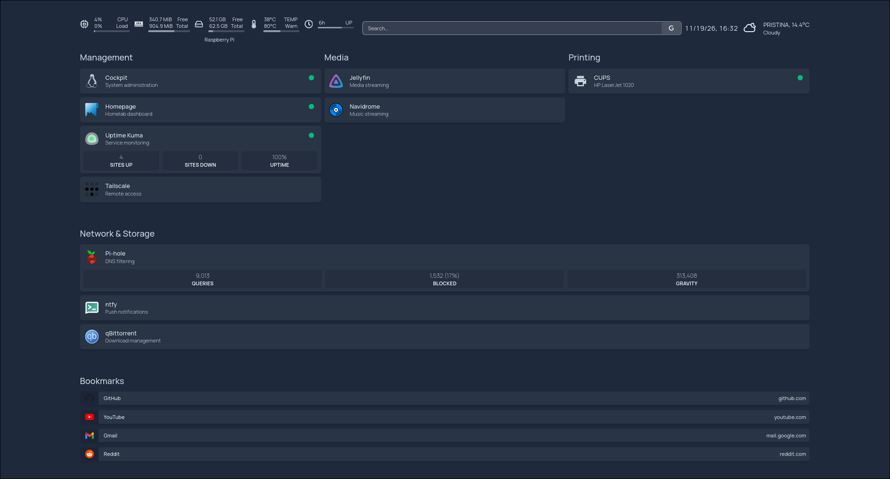
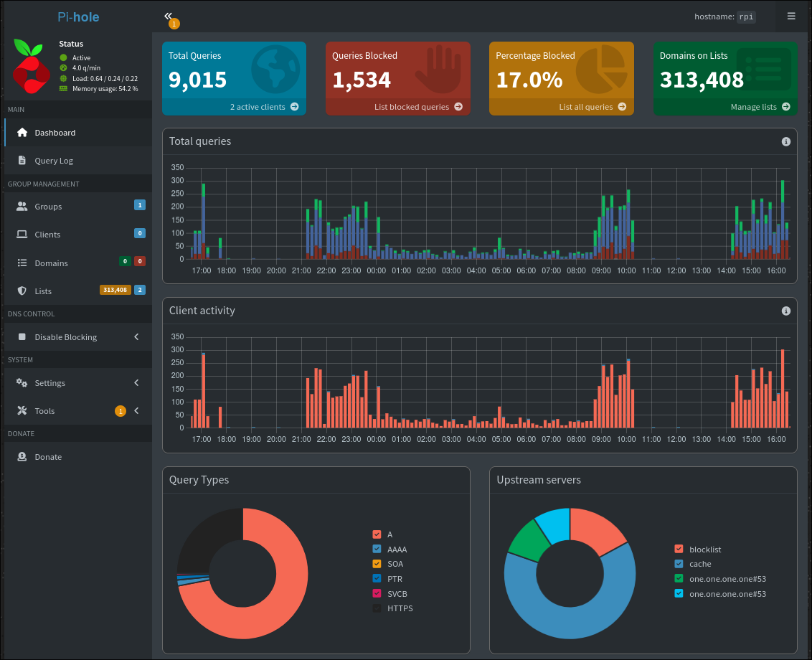
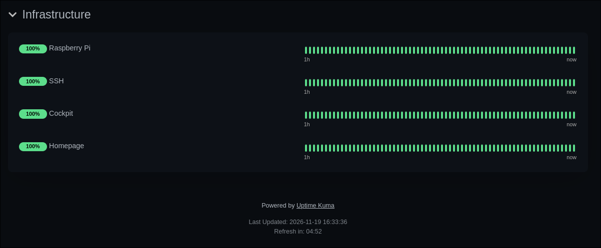

# Raspberry Pi Homelab


Self-hosted infrastructure on a Raspberry Pi 3B+ (1 GB RAM): DNS filtering, containerised services, uptime monitoring, push notifications, network printing and secure remote access. Native systemd services and Docker Compose stacks run behind a default-deny firewall, administered headlessly over SSH and Cockpit.

## Skills demonstrated

| Area | Implementation |
|---|---|
| Linux administration | Debian 13 on ARM64, systemd services, NetworkManager, headless management over SSH and Cockpit |
| Containers | Three Docker Compose stacks with restart policies and persistent bind-mounted volumes |
| DNS and networking | Pi-hole DNS sinkhole blocking 305,158 domains, Cloudflare upstreams, query logging, Docker bridge network analysis |
| Security | Default-deny UFW, LAN-scoped access rules, authenticated ntfy, WireGuard-based remote access with no port forwarding |
| Monitoring | Uptime Kuma health checks, Homepage status dashboard, ntfy push notifications |
| Troubleshooting | Root-cause analysis from kernel firewall logs, container logs and in-container tests ([details](docs/network.md#container-to-host-traffic)) |

## Architecture



## Services

| Service | Role | Deployment | Access | Status |
|---|---|---|---|---|
| [Pi-hole](docs/services/pihole.md) | DNS filtering and ad blocking | Native | LAN `:53`, admin `:80` / `:443` | Operational |
| [Tailscale](docs/services/tailscale.md) | Secure remote access | Native `tailscaled` | Tailnet | Operational |
| [Cockpit](docs/services/cockpit.md) | Web-based system administration | Native | LAN `:9090` (HTTPS) | Operational |
| [Homepage](docs/services/homepage.md) | Service dashboard | Docker Compose | LAN `:3000` | Operational |
| [Uptime Kuma](docs/services/uptime-kuma.md) | Service monitoring | Docker Compose | LAN `:3001` | Operational |
| [ntfy](docs/services/ntfy.md) | Self-hosted push notifications | Docker Compose, authentication enabled | LAN `:8080` | Operational |
| [CUPS](docs/services/cups.md) | Network printing (HP LaserJet 1020) | Native, started on demand | LAN `:631` | Operational |
| [Samba](docs/services/samba.md) | File sharing | Native | n/a | In progress |
| [Jellyfin](docs/services/jellyfin.md) | Media streaming | n/a | n/a | Planned |
| qBittorrent | Download management | n/a | n/a | Planned |

**Pi-hole:** Cloudflare upstreams, StevenBlack and HaGeZi Multi Pro blocklists, query logging enabled. Blocking is verified: a known advertising domain resolves to `0.0.0.0`.

**CUPS:** started on demand with the shell aliases `printer-on`, `printer-off` and `printer-status`.

## Hardware and environment

| | |
|---|---|
| Board | Raspberry Pi 3 Model B+ Rev 1.3, 4x Cortex-A53, 1 GB RAM |
| Storage | 64 GB-class microSD |
| OS | Debian GNU/Linux 13.7 (Trixie), 64-bit ARM, kernel `6.18.60+rpt-rpi-v8` |
| Container runtime | Docker CE 29.9.3 with Compose v5.7.1 (official Docker apt repository) |
| Network | `eth0` at `192.168.1.35/24`, gateway `192.168.1.1` |

More detail: [docs/hardware.md](docs/hardware.md) and [docs/network.md](docs/network.md).

## Security

- UFW default deny inbound. Web interfaces (Cockpit, Pi-hole admin, CUPS, Homepage, ntfy) are allowed from `192.168.1.0/24` only.
- Remote access through Tailscale (WireGuard). No router port forwarding.
- ntfy requires login. CUPS administration requires system credentials and is LAN-restricted. Pi-hole answers local networks only.
- No credentials or tokens are stored in this repository.

## Screenshots

| | |
|---|---|
|  |  |
|  |

## Repository structure

```
raspberry-pi-homelab/
├── README.md
├── docs/
│   ├── hardware.md
│   ├── network.md
│   ├── services/
│   └── troubleshooting.md
├── configs/
│   ├── docker/
│   └── homepage/
├── scripts/
├── screenshots/
└── .gitignore
```

## Deployment

Each containerised service has its own directory under `/opt` with a `compose.yaml` and bind-mounted data:

```bash
cd /opt/homepage    && docker compose up -d
cd /opt/ntfy        && docker compose up -d
cd /opt/uptime-kuma && docker compose up -d
```

Native services are installed directly on Debian. Steps per service are in `docs/services/`.

## Progress

**Completed**

- [x] Debian 13 base system with SSH and Cockpit for headless administration
- [x] UFW default-deny firewall with LAN-scoped rules
- [x] Tailscale remote access without router port forwarding
- [x] Pi-hole DNS filtering with two blocklists (305,158 domains)
- [x] Homepage dashboard, Uptime Kuma monitoring and ntfy notifications as Docker Compose stacks
- [x] Network printing with CUPS, printer firmware loading and on-demand service control
- [x] Diagnosed and fixed firewall blocking of container monitoring traffic

**Next**

- [ ] External storage with a persistent mount and a Samba share (postponed until a better power supply is bought)
- [ ] Jellyfin media server (Direct Play)
- [ ] qBittorrent with downloads on external storage
- [ ] Network-wide DNS filtering: DHCP reservation, then router DNS pointed at Pi-hole
- [ ] SSH key-only authentication and automatic security updates
- [ ] Scheduled backups of `/opt` configuration
- [ ] Host-level metrics

## Technologies

Debian 13, systemd, NetworkManager, UFW, Docker, Docker Compose, Pi-hole v6, Tailscale, Cockpit, Homepage, Uptime Kuma, ntfy, CUPS, Samba.
